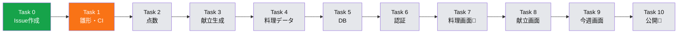
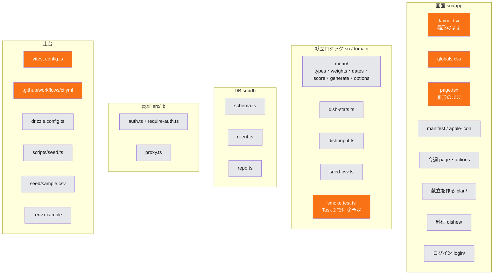

# 進行状況

最終更新: 2026-10-13(Task 1 の PR 作成時)
現在地: Task 1(雛形・CI)の PR #20 がマージ待ち。アプリの部品はまだ main に入っていない [台帳: Task 1 complete]

## 進捗図

凡例: 緑 = マージ済み / オレンジ = PR がマージ待ち / 灰色 = 未着手 / 🧑 = あなたの作業がある

Task 0 は GitHub 上の操作のみ(コードなし)で、台帳に「Task 0: complete」とある [台帳: Task 0]。

## 構成図(できている部品)
存在確認は `git ls-tree -r --name-only task/1-scaffold` による。main には app 関連のファイルがまだ無いため、緑の部品は無い。オレンジ = ブランチ `task/1-scaffold` にあり、マージ待ち(PR #20)。

[計画: File Structure] [差分: git ls-tree task/1-scaffold]

## 決定ログ
| 日付 | 決めたこと | 理由 | 決めた人 | 出典 | 仕様書に反映 |
|---|---|---|---|---|---|
| 2026-10-13 | 献立の既定を「次の日曜日から6日分(日〜金)」にした | まとめ買いは土日で、土曜日は外食が多いため | 未確認(仕様書の承認 PR #1 に含まれる) | [PR #1 本文] [git: 665b29c] | 済(spec §7) |
| 2026-10-13 | 「任意の日を除外する機能」を Slice 2 に回した | 土曜の外食などへの対応は、既定の6日で当面足りるため(PR #1 は既定変更の理由のみ記載。この項目の理由は未確認) | 未確認(PR #1 で承認) | [PR #1 本文] [git: 665b29c] | 済(spec §3) |
| 2026-10-13 | 点数の重みは初期値であり、使ってから見直すと明記した | 実際に使わないと適切な値が分からないため | 未確認(PR #1 で承認) | [PR #1 本文] | 済(spec §6) |
| 2026-10-12 | MIT ライセンスを追加した | 理由は PR 本文に無く未確認 | 未確認 | [PR #1 本文] [git: 647cc94] | 対象外 |
| 2026-10-13 | 成功の基準の測り方を計画の Task 10 Step 8 に追加した(週ごとの確定日数・評価率を SQL で出す。「別のにする」の回数は紙に記録) | spec §1 の成功の基準の測り方が計画から漏れていた | 未確認(PR #2 で承認) | [PR #2 本文] [plan Task 10 Step 8] [git: 8fb58c4] | 対象外(spec §1 の基準は既にあり、測り方は計画側のみ) |
| 2026-10-13 | Issue 番号を1つずらした(Task N = Issue #(N+2)) | PR #2 が #2 を使うため | 未確認(PR #2 で承認) | [PR #2 本文] [plan Task 0 Step 2] | 対象外 |
| 2026-10-13 | `dishes.baseTaste`(初期評価)を追加。美味しさは「評価の平均 → なければ baseTaste → なければ 3」 | 計画作成時の判断。理由の詳細は計画に無く未確認 | AI(計画作成時)。本人へ説明済み(2026-10-13) | [plan Self-Review メモ] [台帳: Preflight scan T2 Step9] | 未(Task 2 Step 9 で反映予定) |
| 2026-10-13 | `rerollDay` に `skip`(画面側で一度断った料理を除外)を追加 | 同じ2品を行き来しないように | AI(計画作成時)。本人へ説明済み | [plan Task 2 Step 9] [plan Self-Review メモ] | 未(Task 2 Step 9 で反映予定) |
| 2026-10-13 | 「次の日曜日」は、今日が日曜なら今日を開始日にする | 計画作成時の判断。理由は計画に無く未確認 | AI(計画作成時)。本人へ説明済み | [plan Task 2 Step 9] [plan Self-Review メモ] | 未(Task 2 Step 9 で反映予定) |
| 2026-10-13 | 今週の画面の表示範囲を「今日から7日分」から「2日前から6日後まで」に変えた | 評価し忘れた分も付けられるように | AI(計画作成時)。本人へ説明済み | [plan Task 9 Step 6] [plan Self-Review メモ] | 未(Task 9 Step 6) |
| 2026-10-13 | アクセス制限は `middleware.ts` ではなく `src/proxy.ts` にする | Next.js 16 で middleware が非推奨のため | AI(計画作成時) | [plan Global Constraints] | 未(反映する手順が計画に無い。spec §4 は `middleware.ts` のまま) |
| 2026-10-13 | DB 接続エラー用の `error.tsx` は作らず、Next.js 既定のエラー画面に任せる | 計画作成時の判断。理由は未確認 | AI(計画作成時) | [plan Self-Review メモ] | 未(反映する手順が計画に無い。spec §8 は error boundary で再読み込みを促す、のまま) |
| 2026-10-13 | Ruling 1: 各 Task の PR を人間がマージするまで次の Task に進まない | 計画の Global Constraint(人間が main にマージする)を、連続実行より優先 | コントローラー(AI) | [台帳: Ruling 1] | 対象外 |
| 2026-10-13 | Ruling 2: git worktree は使わず、Task ごとのブランチで作業する | 計画が `task/<N>-<slug>` ブランチを指定しており、一人用のリポジトリでは足りる | コントローラー(AI) | [台帳: Ruling 2] | 対象外 |
| 2026-10-13 | Ruling 3: Task 0(GitHub の Issue 作成)は実装者・レビュアーを使わず直接実行 | コードもレビュー対象も無いため | コントローラー(AI) | [台帳: Ruling 3] | 対象外 |
| 2026-10-13 | Ruling 4: コミットの Co-Authored-By は計画の固定文字列ではなく、書いたモデルの実名を許す | 正確な記録を優先 | コントローラー(AI) | [台帳: Ruling 4] [レビュー: Important 1] | 対象外 |
| 2026-10-13 | `@types/node` を `^20` から `^22` に上げた(Task 1) | Vitest 5 が `^22` 以上を要求。CI の Node 22 とも合う | 実装者(AI) | [報告: Deviations 1] [レビュー: Implementer deviation] | 対象外 |

## 持ち越し(後で扱う指摘)
- `.gitignore` から `Thumbs.db` と `*.log` が消えた。`.env*` が2回書かれている [台帳: Task 1 minor]
- `layout.tsx` のタイトル "Create Next App" と `lang="en"`(Task 7 で置き換え)、`README.md` が雛形のまま、`AGENTS.md` が自動生成のまま [台帳: Task 1 minor]
- `npm audit` の高リスク警告5件(未調査) [台帳: Task 1 minor]
- 未確認: `npm run build` は未実行。`layout.tsx` が参照するフォント変数が `globals.css` から消えた影響は見た目を確認していない [報告: Concerns]
